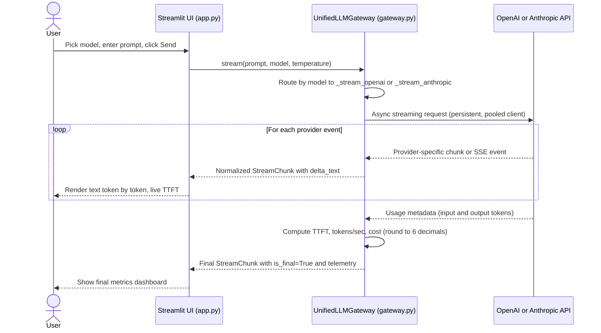

# ⚡ Multi-Provider Async LLM Gateway

A unified, asynchronous streaming gateway for **OpenAI** and **Anthropic** models, with real-time telemetry (Time-to-First-Token, tokens/sec, token counts) and micro-cent cost accounting, plus a Streamlit web interface.

- **Live app:** https://ad331-llm-gateway-a5zqcqubgpx8oq4vvzbxnu.streamlit.app/
- **Video walkthrough:** https://youtu.be/
- **Author:** Nha · AD331, North Seattle College

---

## 1. Project Overview

Different LLM providers stream responses in different formats:

| | OpenAI | Anthropic |
|---|---|---|
| Text chunks | `choices[0].delta.content` | `content_block_delta` events |
| Input tokens | Final usage chunk (`stream_options={"include_usage": True}`) | `message_start` event |
| Output tokens | Final usage chunk | `message_delta` events (running total) |

`UnifiedLLMGateway` hides these differences. Every provider's stream is converted into the same typed Pydantic model, `StreamChunk`, so the web app never needs to know which provider it is talking to.

### Architecture



### Key design points

- **Fully async:** uses the official `AsyncOpenAI` and `AsyncAnthropic` clients. `stream()` is an `AsyncGenerator[StreamChunk, None]`, so nothing blocks the event loop.
- **Persistent clients:** each provider client is created once and reused on the gateway instance, which keeps HTTP connections pooled.
- **Streamlit bridge:** Streamlit reruns the script on every click and isn't async. `app.py` runs one background event loop (cached with `@st.cache_resource`) and pulls chunks from the gateway one at a time. This avoids `Event loop is closed` errors and keeps the gateway's clients alive between requests.
- **Typed errors:** provider failures are converted into `AuthenticationError`, `RateLimitExceededError`, or `GatewayProviderError`. Messages include the error type (e.g. `BadRequestError`) but never the API key or the original provider message.

### Project structure

```
├── .env.example          # Template for required API keys
├── .streamlit/
│   └── config.toml       # UI theme
├── ai_prompt_log.md      # AI prompt, original AI output, and audit findings
├── pyproject.toml        # Dependencies and pytest config
├── requirements.txt      # Exported dependencies for Streamlit Cloud
├── try_gateway.py        # Quick terminal smoke test for both providers
├── src/
│   ├── app.py            # Streamlit web interface
│   ├── gateway.py        # UnifiedLLMGateway: streaming, normalization, telemetry, errors
│   ├── pricing.py        # Model pricing table (USD per 1M tokens)
│   └── schemas.py        # Pydantic models: StreamChunk, ChunkTelemetry
└── tests/
    ├── test_gateway.py   # Streaming, token count, telemetry tests
    └── test_security.py  # Missing/malformed keys, secret redaction tests
```

---

## 2. Environment & Prerequisites

- **Python 3.12** (the assignment requires 3.11+)
- **[uv](https://docs.astral.sh/uv/)** for dependency management
- An **OpenAI API key** and an **Anthropic API key** with prepaid credits

Install uv:

```bash
# Windows (PowerShell)
powershell -ExecutionPolicy ByPass -c "irm https://astral.sh/uv/install.ps1 | iex"

# macOS / Linux
curl -LsSf https://astral.sh/uv/install.sh | sh
```

Clone the repo and install dependencies:

```bash
git clone https://github.com/nhapham03/AD331-LLM-gateway.git
cd AD331-LLM-gateway
uv sync
```

---

## 3. Configuration & Security

Copy the example file and add your own keys:

```bash
# Windows (PowerShell)
Copy-Item .env.example .env

# macOS / Linux
cp .env.example .env
```

Then edit `.env`:

```
OPENAI_API_KEY=your_openai_key_here
ANTHROPIC_API_KEY=your_anthropic_key_here
```

**Security notes**

- `.env` is listed in `.gitignore` and is never committed.
- Keys are read with `os.getenv()` on the server only. They are never sent to the browser.
- Error messages are sanitized: the original provider exception is dropped with `raise ... from None`, so keys can't leak through error text or tracebacks. This is verified by `tests/test_security.py`.
- On Streamlit Community Cloud, keys are stored in the platform's **Secrets** manager, not in the repo.

---

## 4. Running the Project

**Web interface:**

```bash
uv run streamlit run src/app.py
```

Then open http://localhost:8501.

**Quick terminal smoke test** (streams one prompt from each provider and prints telemetry):

```bash
uv run python try_gateway.py
```

**Test suite:**

```bash
uv run pytest -v
```

Expected result: **11 passed**.

| Test | What it verifies | Uses real API? |
|---|---|---|
| `test_unified_stream_protocol` (×2) | Both providers yield valid `StreamChunk`s that join into the expected text, with exactly one final chunk | No (fake clients) |
| `test_prompt_token_count_matches_tiktoken` | A 50-word prompt's reported input tokens are within ±10% of the tiktoken estimate | Yes (OpenAI, skipped if no key) |
| `test_telemetry_sanity` (×2) | Final chunk has cost > 0, tokens/sec > 0, TTFT > 0 | No |
| `test_missing_key_raises_authentication_error` (×2) | A missing key raises a descriptive `AuthenticationError` | No |
| `test_malformed_key_raises_authentication_error` (×2) | A fake key is rejected by the real API and mapped to `AuthenticationError` | Yes (free, needs internet) |
| `test_errors_never_contain_api_key` (×2) | Even when the underlying error contains the key, it never appears in the error text, repr, traceback, or printed output | No |

---

## 5. Pricing Matrix

Prices used for telemetry, in USD per 1,000,000 tokens. **Verified against the official pricing pages on Oct 24, 2026.**

| Provider | Model | Input / 1M tokens | Output / 1M tokens | Source |
|---|---|---|---|---|
| OpenAI | `gpt-4o-mini` | $0.15 | $0.60 | OpenAI developer pricing page |
| OpenAI | `gpt-4o` | $2.50 | $10.00 | OpenAI developer pricing page |
| Anthropic | `claude-haiku-5-5` | $0.10 | $0.50 | claude.com/pricing (API) |
| Anthropic | `claude-sonnet-5-5` | $2.00 | $10.00 | claude.com/pricing (API) |

**Cost formula:**

```
cost = round((input_tokens × input_price + output_tokens × output_price) / 1,000,000, 6)
```

**Notes**

- Claude Haiku 5.5 has a higher price tier for prompts over 100K tokens ($0.50 / $2.50). This gateway uses the standard tier, since the UI is built for short prompts.
- Prices change over time. Re-check the official pages before relying on these numbers.

### Telemetry definitions

| Metric | How it's measured |
|---|---|
| **TTFT** | Time from sending the request to the first **non-empty** text delta (not the first network event) |
| **Tokens/sec** | Output tokens ÷ generation time (total latency − TTFT) |
| **Input / output tokens** | Exact counts from provider usage metadata (OpenAI final usage chunk; Anthropic `message_start` and `message_delta`) |
| **Estimated input tokens** | OpenAI only: tiktoken count + 7 tokens of chat-format overhead. `None` for Anthropic, since tiktoken is OpenAI's tokenizer |
| **Cost** | Formula above, rounded to 6 decimal places |

The live speed shown *while* streaming is an approximate chunks/sec. The exact tokens/sec appears when the final chunk arrives.

---

## 6. Audit & Verification Summary

The first draft was generated with GitHub Copilot Chat. I then ran it against the real APIs and audited it line by line. Full details, including the exact prompt, the unedited AI output, and before/after code for every fix, are in [`ai_prompt_log.md`](ai_prompt_log.md).

| # | Issue in the AI draft | Impact | Fix |
|---|---|---|---|
| 1 | Error messages were too vague (`"Anthropic returned an API error."`) | Failures couldn't be diagnosed | Include the exception type name, which is safe and never contains a key |
| 2 | tiktoken estimate ignored OpenAI's chat-format overhead, and was applied to Claude | Estimate was 41% off (17 vs 10) | Add 7 tokens for OpenAI; no estimate for Anthropic |
| 3 | Catch-all error handler mislabeled the gateway's own bugs as provider errors, and `from None` hid the cause | A `TypeError` was invisible | Found with a temporary debug print; error type now shown in the message |
| 4 | Used `temperature=` on Anthropic's `messages.create()`, which the current SDK removed | **Every Anthropic request crashed** | Removed temperature for Anthropic; current Claude models reject it (400 error) |
| 5 | Cost was not rounded | Floating-point noise (`3.4949999999999996e-05`) | `round(cost, 6)` |
| 6 | Used older-generation prices for the Claude 5.5 models | Haiku costs were **10× too high** | Verified against the official pricing page and corrected |

**Lesson:** the AI produced a solid structure, but it was trained on older SDK versions and couldn't know current prices. Running the code against the actually-installed libraries and checking official sources caught bugs that reading alone would have missed.

---

## 7. Deployment

The app is deployed on **Streamlit Community Cloud**:

1. Dependencies are exported for the platform with:
   ```bash
   uv export --format requirements-txt --no-hashes --no-emit-project -o requirements.txt
   ```
2. App settings: main file `src/app.py`, Python 3.12.
3. API keys are stored in the app's **Secrets** settings:
   ```toml
   OPENAI_API_KEY = "..."
   ANTHROPIC_API_KEY = "..."
   ```
   Streamlit exposes them to the app as environment variables, so the same `os.getenv()` code works locally and in the cloud.

---

## 8. Known Limitations

- **Temperature applies to OpenAI only.** Current Claude models don't accept a temperature setting, so the slider is disabled when Anthropic is selected.
- **Public demo uses the owner's API credits.** Auto-recharge is disabled on both provider accounts to cap spending.
- **Model list is fixed** to the four models in `pricing.py`. Adding a model means adding its verified prices there.

This readme.md was generated by AI
